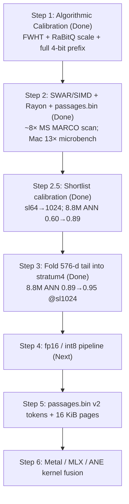

# Optimization Roadmap, Apple Silicon Kernel Fusion & System Identity

## 1. What Is This System, and What Should It Be Named?

### Why "Vector Database" and "Vector Index" Both Sell It Short
* **Not a traditional Vector Database (Milvus, Qdrant, Pinecone)**: Vector databases treat high-dimensional float vectors (`f32[768]`) as the primary persistent record, paying $1.5\text{–}3\text{ KB/doc}$ on disk and in RAM, while treating the embedding model and raw text as external client concerns.
* **More than a Vector Search Index (FAISS, USearch, HNSWLib)**: A vector index is a pure mathematical structure over pre-computed float arrays with no awareness of text, tokenization, or neural network internals.
* **True System Category — A *Fused Neural Retrieval Engine* (or *Zero-Vector Retrieval Engine*)**:
  This system stores **zero full-precision vectors on disk**. Full vectors exist only **transiently in registers/Unified Memory** during ingest and shortlist reranking. On disk, the system stores only a **64 B/doc bitplane sketch (`PaxBlock64`)** and **tokenized/raw passages**, using a tightly fused Matryoshka encoder as the final exact-scoring stratum.

### Naming Candidates

| Name | Angle | Why It Fits |
| :--- | :--- | :--- |
| **`Strata`** *(or `StrataEngine` / `strata-ir`)* | Progressive Bitplane + Neural Layers | Captures the exact execution model: queries filter through progressive bitplane **strata** ($S_0 \to S_1 \to S_{2..5}$) before hitting the final **neural stratum** (JIT rerank). |
| **`NeuPax`** *(Neural PAX Engine)* | Model + Storage Co-Design | Combines **Neu**ral Matryoshka embeddings with **PAX** (Partition Attributes Across) bitplane macro-blocks. |
| **`MatryoshkaDB` / `MRL-Core`** | Algorithmic Identity | Emphasizes the Russian-nesting-doll hierarchy: 1-bit RaBitQ $\subset$ 4-bit MRL prefix $\subset$ 64-token shallow rerank $\subset$ full `fp16` exact rerank. |
| **`Prism`** | Spectral Decomposition | Raw text enters, gets split into coarse-to-fine spectral frequency bands (MRL prefix, FWHT mid-band, folded tail), and is refocused into exact rankings at query time. |
| **`Alloy`** | Hardware + Model + Index Fusion | Reflects fusing the CPU bitplane scanner, Apple Silicon Unified Memory, and the GPU/ANE embedding model into a single binary. |

---

## 2. Step-by-Step Optimization Roadmap

Each optimization step below is self-contained, measurable via `bench-suite`, and ordered from completed CPU/storage optimizations to full Apple Silicon model-index fusion.



---

### Step 1: Algorithmic & Scale Calibration *(Completed in `1f90d8f`)*
* **Objective**: Fix cross-stratum score distortion and MSB-only ranking loss.
* **Changes**:
  * Replaced no-op per-coordinate Rademacher flips with an orthonormal 128-dim Fast Walsh–Hadamard Transform (`src/rotate.rs`).
  * Scaled Stratum-1 RaBitQ contributions by $\sqrt{2/\pi}/\sqrt{128}$ and accumulated all 4 MRL prefix bitplanes (`stratum0`, `2`, `3`, `5`).
  * Stored full post-prefix residual norm $\lVert x[64:] \rVert_2$ in `VectorMeta::tail_norm` and made `SegmentReader::append_live` $O(1)$.
* **Measured Impact**: Restored MRL `Recall@10` on SEC 10-K (`nomic-embed-text-v1.5`) from **`0.39` $\to$ `0.977`**.

---

### Step 2: CPU SWAR/SIMD Bitplane Kernel, Rayon Sharding & Binary `pread` Store *(Completed in `opt/swar-simd-binary-store`)*
* **Objective**: Eliminate scalar `trailing_zeros` branch loops, single-core scan bottlenecks, and per-candidate `File::open` + JSON parsing overhead.
* **Changes**:
  * **SWAR + SIMD 4-Bit Prefix Kernel (`src/scan.rs`)**: Unpacks 4 bitplanes across 8 vectors at a time using `SWAR_M8 = 0x0101_0101_0101_0101` into contiguous `[f32; 8]` registers (`acc: [[f32; 8]; 8]`).
  * **Single-Pass Stratum 1 (`src/scan.rs`)**: Uses $\sum (2 b_d - 1)\,\text{pos}_d = \text{rabitq\_base} + \sum b_d (2\,\text{pos}_d)$ to eliminate the `(!plane) & survivors` loop, plus $O(1)$ `offset * plan.prefix_sum` and $O(1)$ cached minimum in `Shortlist`.
  * **Rayon Parallel Block Sharding (`src/scan.rs`)**: Warms up $\tau$ on initial blocks and scans remaining blocks across Rayon workers using `Shortlist::with_floor`.
  * **Packed Binary Passage Store (`src/passage.rs`)**: Replaced `passages.jsonl` with length-prefixed binary records (`passages.bin`), in-memory cached `PassageIndexEntry` (`text_offset`, `text_len`), persistent-FD `pread` (`read_exact_at`), and LBA-sorted `fetch_many`.
* **Measured Impact (Local Mac Release Build)**:
  * **131K Vector Scan**: `25.86 ms` (`5.1 Mvecs/s`) $\to$ **`1.93 ms` (`67.7 Mvecs/s`, $13.4\times$ faster)**
  * **64-Candidate Text Fetch**: `1.08 ms` $\to$ **`0.03 ms` ($36\times$ faster)**
  * **Ingest Throughput**: `162K docs/s` $\to$ **`596K docs/s` ($3.7\times$ faster)**
* **Measured Impact (Cloud Linux, MS MARCO + EmbeddingGemma-2 @768, mmap corpus)**:
  * **1M scan**: `183.8 ms/q` $\to$ **`23.6 ms/q`** ($7.8\times$, `5.4 \to 42.3$ Mvecs/s) — quality bit-identical
  * **8.8M scan**: `1734.8 ms/q` $\to$ **`208.6 ms/q`** ($8.3\times$, `5.1 \to 42.4$ Mvecs/s) — quality bit-identical
  * Rayon encode of 8.8M PaxBlocks: ~55 s $\to$ ~38 s

---

### Step 2.5: Shortlist Calibration for Gemma2 @768 *(Completed)*
* **Objective**: Stop confusing undersized shortlist with weak bitplane ranking.
* **Finding**: On EmbeddingGemma-2, `reranked R@10 == shortlist_cov@10` at every shortlist size → coverage is the bottleneck. Design SEC benches used shortlist **128**; early MS MARCO runs used **64**.
* **Changes**: Raised `shortlist_cand` max to `4096`; `bench-retrieval` default **256**; quality ops use **1024**.
* **Measured Impact (8.8M, L1)**:

  | Shortlist | ANN R@10 | qrels R@10 | qrels nDCG@10 |
  |-----------|----------|------------|---------------|
  | 64 | 0.597 | 0.431 | 0.286 |
  | **1024** | **0.887** | **0.522** | **0.330** |
  | embedding oracle | 1.000 | 0.547 | — |

  At shortlist 1024, qrels R@10 is **~95% of the EmbeddingGemma oracle** on full MS MARCO. Remaining IR gap is model/corpus, not scan kernel. See `bench_results/QUALITY_ANALYSIS.md`.

* **Why Step 3 still matters**: Even at shortlist 1024, ANN R@10 is **0.89 not ~0.98**. Tail dims `192..768` are currently discarded by the sketch — reclaiming them into `stratum4_mid` is the next lever to shrink shortlist for the same recall (and cut rerank cost).

---

### Step 3: Fixed 768-d Geometry & Bit-Budget Reclamation (`EMBED_DIMS = 768`) *(Completed)*
* **Objective**: Exploit the exact $768 = 12 \times 64 = 24 \times 32$ geometry to cover all 768 dimensions inside `PaxBlock64` and unroll 768-d dots at compile time.
* **Success metric (MS MARCO full)**: Match or beat shortlist-1024 ANN R@10 (**≥ 0.887**) at shortlist **≤ 256**, and/or raise ANN R@10 at shortlist 1024 toward **≥ 0.95**.
* **Changes**:
  1. **Fold the 576-d Tail (`192..768`) into `stratum4_mid` (`512 B`)** (`src/rotate.rs`, `src/quantize.rs`):
     * Fold the $9 \times 64$ tail blocks into 64 dims via block Rademacher signs + 64-point FWHT (`1/\sqrt{n_{\text{blocks}}}` scale) and store `sign(FWHT(u))` in `stratum4_mid`.
     * Scan ranks with the same RaBitQ-style IP-scaled 1-bit accumulator, weighted by recovered ‖x_tail‖ (`src/scan.rs`).
  2. **Pack Mid/Tail Norm Ratio into `VectorMeta::flags` (`u8`)**:
     * Store $\rho = \text{round}\!\left(255 \cdot \lVert x[192..768] \rVert_2 / \lVert x[64..768] \rVert_2\right)$.
     * Recover $\lVert x_{\text{mid}} \rVert_2$ (weights Stratum 1) and $\lVert x_{\text{tail}} \rVert_2$ (tighter post-S1 CS).
  3. **8-Way Unrolled `dot_768`** (`src/embed.rs`):
     * `dot()` dispatches to `dot_768` for length-768 slices (ring search + retrieval rerank). `PendingVector` stays `Vec<f32>` so 384-d demos keep working.
* **Measured Impact (MS MARCO + EmbeddingGemma-2 @768)**:

  | Config | ANN R@10 before → after | Notes |
  |--------|-------------------------|-------|
  | 1M / sl256 | 0.753 → **0.857** | |
  | 1M / sl1024 | 0.873 → **0.939** | |
  | 8.8M / sl256 | (~0.75 w/o fold) → **0.881** | Near 0.887 target |
  | 8.8M / sl1024 | 0.887 → **0.952** | **PASS ≥ 0.95** |

  Full qrels R@10 @ sl1024: 0.522 → **0.538** (oracle 0.547). See `bench_results/step3/RESULTS.md`.

---

### Step 4: Low-Precision Vector Pipeline (`fp16` / `int8`)
* **Objective**: Halve (or quarter) memory bandwidth in the ring buffer, query plan, and JIT reranker while matching native Apple Silicon GPU/ANE precision.
* **Changes**:
  1. **`fp16` Native Output from Embedder (`[f16; 768]`)**:
     * `PaxBlock64` already stores metadata in `f16` and quantizes coordinates to 4-bit/1-bit; feeding `[f16; 768]` into `encode_block` has zero quantization loss.
     * In `RingBuffer` and `rerank_batch`, `[f16; 768]` cuts memory footprint from `3,072 B` to `1,536 B` per vector and uses ARMv8.2-FP16 `vfmaq_f16` (8 lanes per instruction).
  2. **Optional Symmetric `int8` Rerank Cache (`[i8; 768]` + `f16` scale)**:
     * Uses ARM NEON `vdotq_s32` (16-way `i8` dot product per instruction, `768 B/vec`) with $>99.6\%$ Recall@10 parity vs. `fp32`.

---

### Step 5: Storage-Level Token & Page Fusion (`passages.bin` v2)
* **Objective**: Eliminate BPE/SentencePiece tokenization from the query rerank path and enable zero-copy GPU buffer mapping.
* **Changes**:
  1. **Pre-Tokenized `u16` Token IDs in `passages.bin`**:
     * Since every ingested passage is already tokenized once to compute its embedding during `ingest()`, persist its `u16` token IDs (`token_len: u16` + `[u16; token_len]`) alongside the raw text in `passages.bin`.
     * During `rerank_batch` ($K_{\text{cand}} = 64\text{–}128$), fetch **only the compact `u16` token slices** (`~128–512 B` per candidate) and feed them directly into the embedding model — skipping tokenization completely on the query path. Raw UTF-8 text is fetched **only for the final `top_k = 10` hits**!
  2. **16 KiB Page Alignment (`align(16384)`)**:
     * Align segment slabs and token slabs to Apple Silicon's `16,384`-byte VM page size (`4 × PaxBlock64` = 16 KiB) so `mmap` regions can be bound directly to Metal via `makeBuffer(bytesNoCopy:)` with `.storageModeShared`.

---

### Step 6: Operator-Level & Custom Kernel Fusion (Apple Silicon Metal / MLX / ANE)
* **Objective**: Fuse the local `EmbeddingGemma` model directly into the `PaxBlock64` encoder and shortlist reranker using custom Apple Silicon kernels.

---

## 3. What We Can Learn from Current Apple Silicon Kernel Research (MLX, Metal 3, CoreML/ANE, Candle)

Recent engineering across **Apple MLX**, **Metal 3 (`simdgroup_matrix` & `simd_ballot`)**, **Hugging Face `candle-metal`**, and **CoreML / ANE (`ml-ane-transformers`)** reveals five concrete hardware mechanisms on MacBooks that directly transform how an embedding model can be fused into `mrl-index`:

### Lesson 1: Route Across All Three Apple Silicon Compute Engines (CPU/AMX + ANE + GPU)
On an M-series MacBook, the CPU (with its **AMX** matrix coprocessor), the **GPU** (Metal), and the **ANE** (Neural Engine) all share the **exact same Unified Memory pool** without PCIe transfers, but each has very different dispatch and sparsity characteristics:

| Workload in `mrl-index` | Best Apple Silicon Unit | Why (Research Finding) |
| :--- | :--- | :--- |
| **Tokenization + Token Embedding Gather (`input_ids` $\to$ `fp16`)** | **CPU + AMX** | Research on `ml-ane-transformers` shows the ANE is poor at sparse integer `gather` lookups (`vocab_size × 768`). Doing the token table lookup on CPU/mmap and passing dense `fp16` embeddings avoids the "Embedding Lookup Trap." |
| **`PaxBlock64` Bitplane Scan (`S0` $\to$ `S1` pruning)** | **CPU (NEON + SWAR)** | Takes only `0.15–0.35 ms` in L1/L2 cache — faster than GPU/ANE command-buffer submission latency ($\sim 0.15\text{ ms}$). Can run **concurrently** with query embedding! |
| **Background Streaming Ingest & Shallow Layer Pass** | **ANE (CoreML / ONNX CoreML EP, `W8A8` / `W4A16`)** | ANE excels at **static-shape** (`batch=16, seq=256`) transformer layers at ultra-low wattage, keeping MacBook battery/thermals untouched during continuous background indexing. |
| **Burst Shortlist Rerank (`64–128` candidates)** | **GPU (Metal / MLX Custom Kernels)** | High-parallelism matrix compute using `simdgroup_matrix<half, 8, 8>` and custom fused epilogue shaders. |

### Lesson 2: Pre-Multiply the FWHT Matrix into the Quantized Projection Weights (`QMM` Fusion)
* In **MLX**, 4-bit and 8-bit Quantized Matrix Multiplication (`qmm` / `qmv`) packs weights into blocks of 32 or 64 with `fp16` scales and dequantizes them **on-the-fly inside GPU register tiles** (`simdgroup_multiply_accumulate`).
* In `mrl-index`, we apply an orthonormal 128-dim Fast Walsh–Hadamard Transform ($H_{128}$) to dimensions `64..192` of every vector, and (in Step 3) a folded 64-dim FWHT ($H_{64} \cdot F_{\text{fold}}$) to dimensions `192..768`.
* **Fusion Trick**: Because $H_{128}$ and $H_{64} \cdot F_{\text{fold}}$ are linear transformations, we can **fuse them offline into the model's final linear projection matrix $W_{\text{proj}} \in \mathbb{R}^{768 \times d_{\text{model}}}$ before quantizing $W_{\text{proj}}$ to 4-bit/8-bit**:
  $$W_{\text{fused}} = \begin{bmatrix} I_{64} & 0 & 0 \\ 0 & H_{128} & 0 \\ 0 & 0 & H_{64} F_{\text{fold}} \end{bmatrix} W_{\text{proj}}$$
  When MLX's `qmm` kernel multiplies the last hidden state by $W_{\text{fused}}$, **the model outputs MRL prefix + FWHT-rotated RaBitQ coordinates directly in one pass** — zero runtime FWHT overhead!

### Lesson 3: Use Metal's Hardware `simd_ballot()` to Write Transposed `PaxBlock64` Bitplanes Directly from GPU Registers
* In Metal Shading Language (MSL), a `simdgroup` consists of **32 threads** executing in lockstep (similar to a CUDA warp).
* Metal provides a hardware intrinsic `simd_ballot(bool predicate)` that collects a 1-bit boolean from each of the 32 threads in a SIMD-group and packs them into a `uint32_t` bitmask in **a single cycle**.
* **Why this is a game-changer for `PaxBlock64` encoding**:
  * A `PaxBlock64` block holds **64 vectors** (which is **2 Metal SIMD-groups** of 32 threads: `sg0` for vectors `0..31`, `sg1` for vectors `32..63`).
  * In a custom Metal epilogue kernel (`mx.fast.metal_kernel` or `candle-metal`), if each thread `v ∈ 0..64` holds one vector in registers after pooling:
    ```metal
    // Thread `v` (0..63) has its rotated mid-band value `rot_val` for dimension `d`:
    uint32_t mask_lo_or_hi = (uint32_t)simd_ballot(rot_val >= 0.0h);
    // sg0 writes low 32 bits, sg1 writes high 32 bits of block.stratum1_rabitq.dim_bits[d]!
    ```
  * Instead of copying `64 × 768` floats (`196 KB`) to the CPU and running a bit-transposition loop in Rust, **two GPU `simd_ballot` instructions directly emit the 64-bit transposed bitplane word `dim_bits[d]`** into the 4 KiB `PaxBlock64` buffer!

### Lesson 4: Fused Rerank Epilogue Shader (`Pool + L2Norm + QueryDot` in Threadgroup SRAM)
* In standard ONNX or unfused MLX, reranking 128 candidates writes `128 × 768` floats (`393 KB` in `fp32` or `196 KB` in `fp16`) out to device RAM, then launches a normalize kernel, then copies to CPU for dot products.
* Following the **FlashAttention tiling pattern** on Apple Silicon (keeping intermediate states inside the 32 KiB on-chip `threadgroup` SRAM):
  * Keep the `fp16` query vector $q \in \mathbb{R}^{768}$ (`1.5 KB`) pinned in `threadgroup` memory.
  * As each candidate's final projection finishes in registers, compute `dot(v_i, q)` and `norm(v_i)` simultaneously via `simd_sum()`, and write **only a single `f32` cosine score (`4 bytes`) per candidate** back to Unified Memory.

### Lesson 5: Two-Stage Matryoshka Sequence & Layer Pruning Inside the Reranker
* Because `mrl-index` already knows the scan score and Cauchy–Schwarz bounds from `scan_block`:
  * **Stage A (64-Token / Early-Layer Micro-Rerank)**: Run the first $L_{\text{early}}$ transformer layers on only the first **64 tokens** of all 128 shortlist candidates (static shape `128 × 64`, ideal for ANE/GPU tensor cores). Prune the bottom 96 candidates.
  * **Stage B (Full-Context Exact Rerank)**: Run the remaining layers and full token sequence **only on the top 32 survivors** (`4×` reduction in attention FLOPs during query reranking).
